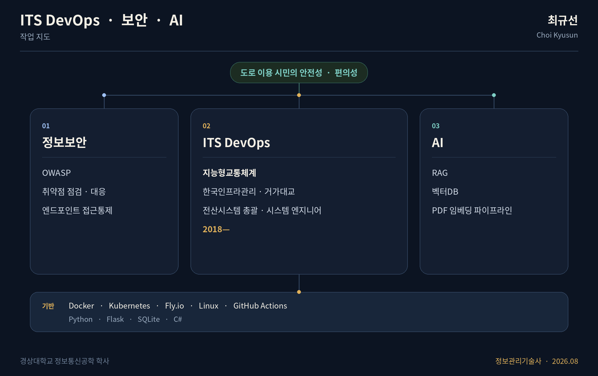

정보관리기술사 · 시스템 엔지니어

한국인프라관리(거가대교) 전산시스템 총괄 · 2018—

[최규선.com](https://xn--9h0bj97ao2i.com)

## 소개

최규선(Choi Kyusun)입니다. 경상대학교 정보통신공학 학사입니다. 2018년부터 한국인프라관리에서 거가대교 전산시스템을 총괄하는 시스템 엔지니어로 일하고 있으며, 2026년 8월 정보관리기술사를 취득했습니다.

DevOps 기반 지능형교통체계(ITS) 전문가로, 도로를 이용하는 시민의 안전성과 편의성을 높이는 일을 목표로 합니다. 관심 분야는 정보보안, IT 인프라(Docker, Kubernetes, Fly.io), AI(RAG, 벡터DB), OWASP입니다.

## 기술

  
  
  
  
  
  
  
  
  

## 작업 지도

맡은 일과 관심 분야를 한 장에 둔 지도입니다. 거가대교 설비의 내부 구성은 아닙니다.

## 저장소

한 줄 설명은 각 저장소 README를 기준으로 적었습니다.

### 정보보안

<table>
<tr>
<td width="50%" valign="top">

[**usb-access-control**](https://github.com/kh20134/usb-access-control) · C#

Windows에서 USB 저장장치를 차단, 읽기 전용, 허용으로 통제하는 엔드포인트 도구

</td>
<td width="50%" valign="top">

[**vuln-scanner**](https://github.com/kh20134/vuln-scanner) · Python

인가된 네트워크, 서버, 엔드포인트를 NVD, CWE, KEV, EPSS와 대조하는 취약점 점검 도구

</td>
</tr>
<tr>
<td width="50%" valign="top">

[**fortimail-cve-2026-104286-response**](https://github.com/kh20134/fortimail-cve-2026-104286-response) · Python

FortiMail CVE-2026-104286을 반출한 파일만으로 버전, IoC, 완화 상태를 점검하는 대응 도구

</td>
<td width="50%" valign="top">

[**artex-defense-kit**](https://github.com/kh20134/artex-defense-kit) · Python

ARTEX 식별 문자열과 행위 휴리스틱으로 로그와 호스트 흔적을 보는 탐지 키트

</td>
</tr>
<tr>
<td width="50%" valign="top">

[**owasp-top10-defense**](https://github.com/kh20134/owasp-top10-defense) · Python

OWASP Top 10:2021을 로컬 Flask에서 취약 구현과 안전 구현으로 나란히 고정하는 실습

</td>
<td width="50%" valign="top">

[**owasp-api-top10-kyusun**](https://github.com/kh20134/owasp-api-top10-kyusun) · Python

OWASP API Security Top 10(2023)을 최규선.com(Flask, Fly.io, SQLite)에 적용한 검토와 조치

</td>
</tr>
</table>

### AI

<table>
<tr>
<td width="50%" valign="top">

[**pdf-vector-pipeline**](https://github.com/kh20134/pdf-vector-pipeline) · Python

PDF를 한국어 문장 경계로 나누고 임베딩해 Chroma에서 구절을 찾는 파이프라인

</td>
<td width="50%" valign="top">

[**artex-ko-plus**](https://github.com/kh20134/artex-ko-plus) · Go

ARTEX 한국어판에 AI 침해사고 대응을 더한 AegisLoop 포크. 이 저장소에서 바꾼 것은 문서와 구조도 (AGPL-3.0)

</td>
</tr>
</table>

## GitHub

 

## 최근 글

[최규선.com](https://xn--9h0bj97ao2i.com)에 올린 글입니다.

- [ARTEX 한국어판 artex-ko-plus 구조 및 AI 침해사고 대응 기능 분석](https://xn--9h0bj97ao2i.com/posts/15) · 2026-10-11
- [OWASP API Security Top 10 개념 및 최규선.com 적용 대응방안](https://xn--9h0bj97ao2i.com/posts/14) · 2026-10-11
- [OWASP Top 10 공격기법 및 대응방안](https://xn--9h0bj97ao2i.com/posts/13) · 2026-10-10
- [PDF 벡터 임베딩 및 벡터DB 적재 파이프라인 구축](https://xn--9h0bj97ao2i.com/posts/12) · 2026-10-10
- [ARTEX 탐지·헌팅 키트 구축 프로젝트](https://xn--9h0bj97ao2i.com/posts/11) · 2026-10-10
